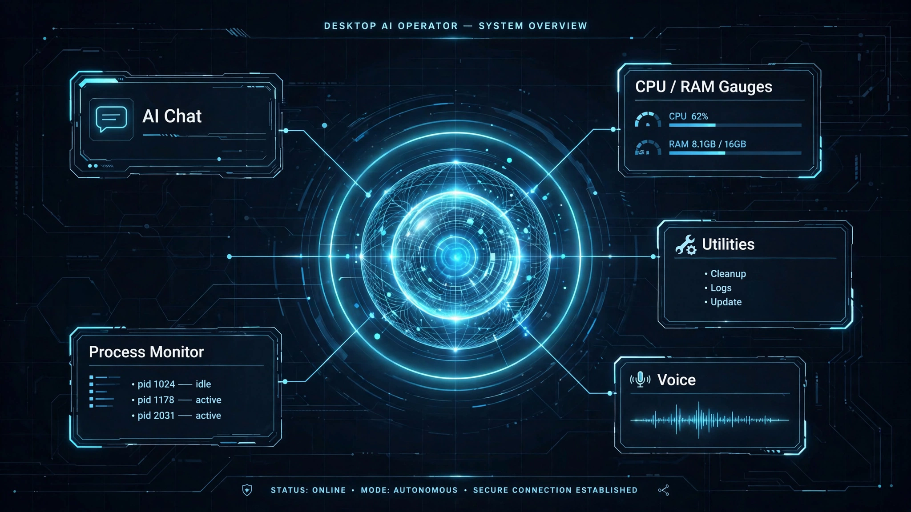

# ⚡ DataNest — AI Desktop Operator


> A futuristic standalone Windows AI operator — live hardware telemetry, process supervision, neural voice interaction, and multi-turn conversational intelligence, wrapped in a cyberpunk HUD.



## ✨ What It Does

| Module | What You Get |
| :--- | :--- |
| 🤖 **AI Assistant** | ChatGPT-style scrollable chat, real-time reasoning, automated web tasks |
| 📊 **Telemetry Hub** | Live gauges for CPU load, RAM usage, and disk availability |
| 📈 **Analytics** | Real-time CPU charts alongside logical core thread loads |
| ⚡ **Process Supervisor** | Task-manager view of top processes by memory (MB) and PID |
| 🎙 **Voice Engine** | Threaded voice recognition and spoken responses |
| ⚙ **Utility Deck** | Unit converters and real-time exchange rate estimates |

## 🛠 Tech Stack

- **Interface:** CustomTkinter, Tkinter Canvas (custom charts & glowing AI Orb)
- **Intelligence:** Google GenAI SDK (`gemini-flash-lite`)
- **System Telemetry:** `psutil`
- **Audio & Voice:** `speech_recognition`, `pygame`
- **Assets:** `Pillow` (PIL)

## 📦 Installation & Setup

```bash
git clone https://github.com/waki44/DataNest-AI-Assistant.git
cd DataNest-AI-Assistant

python -m venv venv
venv\Scripts\activate
pip install -r requirements.txt

copy config.example.json config.json
```

Add your key to `config.json`:

```json
{
  "GEMINI_API_KEY": "your_actual_gemini_api_key_here"
}
```

Launch it:

```bash
python gui_assistant.py
```

## 📂 Project Structure

```text
├── gui_assistant.py      # Main HUD interface
├── main_assistant.py     # Assistant entry point
├── agent_core.py         # AI agent logic
├── voice_service.py      # Voice input / output
├── check_models.py       # Model checks
├── config.example.json   # Sample configuration
└── requirements.txt      # Dependencies
```

## 🛡 Security Note

`config.json` is gitignored and never committed. Build artifacts (`dist/`, `build/`) stay local.

---

Built by **Syed Waqar Raza Zaidi** · 🌐 [Portfolio](https://portfolio-website-sigma-ashen-90.vercel.app)
